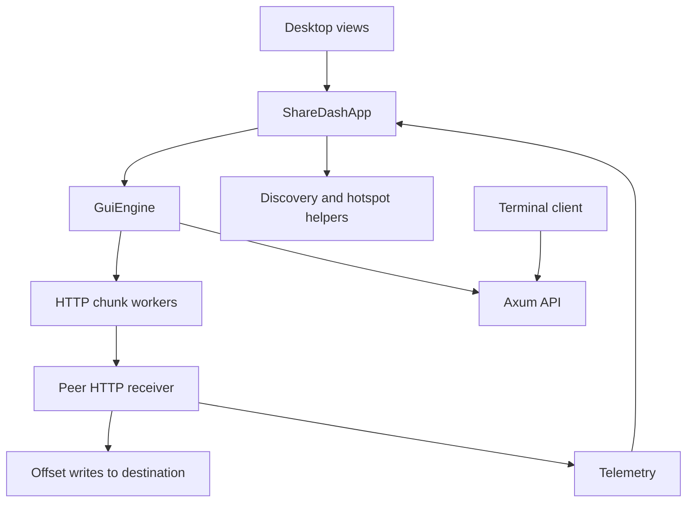

# How ShareDash works

This document describes the implementation in this repository. The native desktop transfer path and the reusable binary-protocol modules are separate paths; features in one should not be assumed to apply to the other.

## Component boundaries



| Component | Main source | Responsibility |
| --- | --- | --- |
| Desktop entry point | [src/bin/sharedash_gui.rs](src/bin/sharedash_gui.rs) | Parse options, create Tokio runtime, start the engine, open GPUI window |
| Desktop controller | [src/gui/app.rs](src/gui/app.rs) | Navigation, background monitors, connection workflows, file dialogs, and progress updates |
| Desktop presentation | [src/gui/](src/gui/) | Home, phone setup, PC setup, transfer, and device-detail views |
| GUI engine | [src/gui/engine.rs](src/gui/engine.rs) | HTTP service startup, peer probes, pairing helpers, archives, chunk dispatch |
| HTTP API | [src/server/api.rs](src/server/api.rs) | Device information, pairing, transfer reception, cancellation, and network actions |
| Discovery | [src/discovery/](src/discovery/) | Local UDP beacons, PIN/QR pairing helpers |
| Network orchestration | [src/hotspot.rs](src/hotspot.rs) | Adapter inspection, ADB/tethering support, hotspot selection and connection helpers |
| Protocol library | [src/protocol/](src/protocol/) | Binary framing, messages, AES-GCM and hash utilities |
| Scheduler and storage | [src/scheduler/](src/scheduler/), [src/storage/](src/storage/) | Framed-transfer scheduling, manifests, sparse writes, integrity utilities |

## Startup and concurrency

The GUI entry point starts a multi-threaded Tokio runtime and initializes `GuiEngine`. The engine creates the Axum service, pairing/discovery state, telemetry channel, and manifest database. GPUI owns the desktop window and view state.

Background Tokio tasks perform networking and hardware inspection. Futures channels carry their results back to the GPUI application. UI updates call `cx.notify()` to render new state.

The hardware monitor normally runs about every 1.5 seconds. The ADB monitor normally checks every 3 seconds. Both pause their recurring work while the GUI sender's transfer-active flag is set, reducing interference during transmission.

The terminal entry point initializes `Server`, which starts the HTTP service and interactive terminal loop. The GUI starts its own service without launching that loop.

## Discovery and connection setup

### UDP discovery

ShareDash broadcasts discovery beacons on UDP port `54320`. Peers use HTTP to exchange capabilities and pair. [UDP discovery implementation](src/discovery/mdns.rs)

### Phone setup

The desktop phone assistant displays five stages:

| Stage | Work |
| --- | --- |
| USB | Detect tethering or an authorized ADB device |
| Capabilities | Query local and remote Wi-Fi capabilities |
| Host | Choose or report a hotspot host |
| Wi-Fi | Request the phone hotspot and associate the PC; attempt fallback setup when applicable |
| Ready | Verify reachable endpoints and carry connection settings into the transfer view |

USB tethering exposes a network interface. ADB uses TCP forwarding: local `127.0.0.1:54325` reaches the phone's `54321` service. Reverse forwarding supports traffic in the other direction.

The current phone workflow prefers requesting a phone-hosted hotspot over the USB connection. It also contains Windows hotspot fallback logic. Hotspot creation and band selection are hardware- and OS-dependent.

The USB-skip control updates the assistant's state. It should not be read as evidence of a complete USB-free automatic pairing implementation.

### PC setup

The PC view starts discovery, lists candidates, and invokes the existing pairing helper for a selected peer. A separate action probes and pairs with the saved IP address. The latter updates the view on success; the discovered-peer callback currently invokes the handshake without the same explicit transfer-target update.

The saved address defaults to `192.168.137.1:54321`. There is no editable address control in the current GUI.

### Pairing is distinct from transfer authorization

The code contains both PIN/QR session helpers and a request/response/confirmation pairing flow. These manage session and peer state. The HTTP chunk receiver does not enforce those tokens as per-request authorization. Pairing must not be documented as end-to-end encryption.

## Desktop sending path

### Content preparation

A file is memory-mapped for reading. For a directory, the GUI first creates a ZIP file in the system temporary directory under `sharedash_archives`. It uses ZIP's stored method, preserving relative file paths without compression. Empty directory entries are not explicitly added.

The sender attempts to remove the temporary archive after workers finish. Errors or interruption can leave temporary files; a successful cleanup is not guaranteed.

### Chunk sizing

`GuiWorkDispatcher` computes chunks for the desktop HTTP sender:

| File size | Base chunk size |
| --- | --- |
| Below 10 MiB | 1 MiB |
| 10 MiB to below 50 MiB | 2 MiB |
| 50 MiB and above | 4 MiB |

Near the end of a large file, chunks reduce to 2 MiB and then 1 MiB. The final chunk can be smaller. These values belong to the GUI dispatcher; they are not the same as every other chunker in the repository.

### Dispatch and retries

The sender creates four asynchronous workers per selected target. Workers pull from a shared queue, allowing a faster connection to claim more work.

The dispatcher tracks unassigned, in-flight, completed, and retried chunks. A worker can reclaim another transport's chunk after 2.5 seconds in flight. Failed chunks can return to the queue up to five times before the dispatcher marks a fatal error.

Each worker posts bytes to:

```text
POST /api/v1/transfers/chunk
```

The request includes transfer ID, filename, total size, chunk ID, offset, length, total chunk count, transport metadata, and a CRC32 checksum. The HTTP client uses keep-alive, TCP_NODELAY, and a 60-second request timeout.

Successful HTTP responses advance progress once per chunk ID. Responses `409` or `410` are treated as cancellation. Other errors are retried. Cancellation also uses the existing shared atomic flag.

### Progress reporting

The sender emits a snapshot roughly every 100 ms. Channel speed is calculated as bytes sent divided by elapsed transfer time, so the desktop labels it **average** speed. ETA derives from remaining bytes and that average.

Snapshots provide aggregate byte progress and acknowledged chunk counts. They do not contain a verified per-piece bitmap or exact in-flight count. The desktop's segmented activity view therefore represents byte progress only.

The completion object's `integrity_ok` field is derived from worker outcomes and dispatcher errors. It is not a receiver-side whole-file hash certificate.

## Windows receiving path

The chunk receiver extracts the filename, takes its basename, and replaces reserved filename characters. It creates or opens the destination under `Downloads/ShareDash_Received`, preallocates the reported size, and writes chunks at their reported offsets.

On Windows, it uses positional `seek_write` calls; on Unix, the implementation uses `write_all_at`. The receive session tracks acknowledged chunk IDs and channel bytes in memory.

Checksum handling is conditional:

1. If `x-chunk-crc32` is present, validate CRC32.
2. Otherwise, if `x-chunk-sha256` is present, validate SHA-256.
3. If neither is present, this handler does not perform those checksum checks.

The GUI sender supplies CRC32. A mismatch returns an error so the sender can retry. CRC32 detects accidental corruption; it does not authenticate the sender.

The receiver publishes progress through the telemetry channel. The GUI listens directly to that channel; `/ws/telemetry` exposes it to WebSocket clients. Chunk receive sessions use an in-memory registry rather than the manifest database, so the live GUI path does not provide restart-resume from SQLite.

Files with the same destination name can reuse and overwrite existing data. There is no rename-on-conflict policy in this handler.

## Binary-protocol library

The reusable library has additional facilities:

- `FrameCodec` encodes and decodes binary frames with CRC32.
- `SessionCrypto` supports AES-256-GCM or an unencrypted mode, plus SHA-256 and BLAKE3 helpers.
- `MultipathScheduler` and `ChunkPool` schedule framed transfers.
- `ManifestDb`, `AdaptiveChunker`, and `SparseWriter` support manifests and file reconstruction.
- Mock transports support corruption and failover tests.

These facilities are tested independently. Their presence does not mean that the GUI's HTTP body is encrypted or that its complete output is hash-verified.

The module named `QuicInetTransport` currently wraps TCP with `FrameCodec`. It is not a QUIC implementation.

## HTTP surface

The GUI engine and terminal server register largely the same routes:

| Method | Route or group | Purpose |
| --- | --- | --- |
| GET | `/api/v1/info`, `/api/v1/peers` | Local identity and discovered peers |
| GET | `/api/v1/bridges`, `/api/v1/transports/detect` | Connection inspection |
| POST | `/api/v1/pair/create`, `/verify` | PIN session creation and verification |
| POST | `/api/v1/pair/request`, `/respond`, `/confirm`, `/connect` | Peer pairing flow |
| GET | `/api/v1/pair/incoming`, `/status` | Pairing state |
| GET | `/api/v1/wifi_caps` | Wi-Fi capabilities |
| POST | `/api/v1/wifi_connect`, `/api/v1/hotspot/start` | Network setup |
| POST | `/api/v1/hotspot/open-settings`, `/api/v1/storage/open_folder` | Local system actions |
| GET | `/api/v1/transfers` | Transfer listing |
| POST | `/api/v1/transfers/prepare`, `/send`, `/chunk` | Transfer preparation and receive paths |
| POST | `/api/v1/transfers/:id/cancel`, `/api/v1/transfers/cancel` | Cancellation |
| POST | `/api/v1/benchmark/start` | Benchmark transfer |
| GET / WebSocket | `/ws/telemetry` | Transfer telemetry |

Short route suffixes in a row share the full prefix of that row's first route. Consult the router definitions for exact paths and [src/server/api.rs](src/server/api.rs) for request types. This table is an implementation map, not a versioned API stability promise.

## Ports and local data

| Resource | Default |
| --- | --- |
| HTTP and WebSocket service | TCP `54321`, bound to `0.0.0.0` |
| UDP discovery | UDP `54320` |
| ADB forwarding endpoint | TCP `54325` |
| Manifest database | `./sharedash_data/manifest.db` |
| Device identity | `./sharedash_data/device_id.txt` |
| Windows received files | `%USERPROFILE%/Downloads/ShareDash_Received` |
| Temporary folder archives | System temporary directory, `sharedash_archives` |

The static [docs/](docs/) website is deployed separately. The service router does not mount it as a browser transfer dashboard.

## Validation boundaries

Protocol, corruption, and failover tests exercise the binary library and simulated transports. GUI compilation validates the desktop code, but neither check proves interoperability with a particular phone, hotspot driver, or cable.

For a release, validate actual transfers in both directions, each connection mode, cancellation, retries, filename collisions, and independent destination hashes. See [CONTRIBUTING.md](CONTRIBUTING.md) and [SECURITY.md](SECURITY.md).
