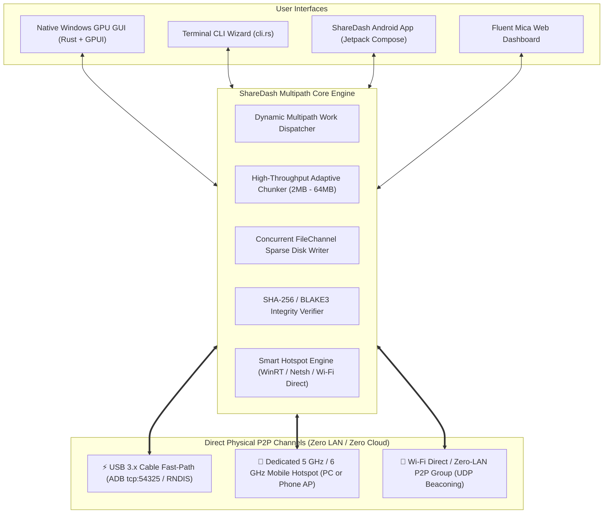

# ⚡ ShareDash

<div align="center">

---

## 💡 Why ShareDash? (Comparison vs Alternatives)

Most existing file transfer tools rely on a single wireless channel or an existing local Wi-Fi router. **ShareDash** is built for extreme performance, aggregating multiple physical hardware interfaces concurrently without requiring any internet connection, router, or cloud account.

| Feature / Capability                              |    ⚡ **ShareDash**    |   🍏 AirDrop   |  📲 Quick Share  |    📦 LocalSend    |    🔄 Syncthing    |
| :------------------------------------------------ | :---------------------------: | :------------: | :---------------: | :----------------: | :----------------: |
| **Simultaneous Multipath (USB + Wi-Fi)**    | ✅ **YES (Aggregated)** |     ❌ No     |       ❌ No       |       ❌ No       |       ❌ No       |
| **100% Offline / Routerless (Zero LAN)**    | ✅ **YES (Direct P2P)** |     ✅ Yes     |      ✅ Yes      | ❌ Requires Router | ❌ Requires Router |
| **PC <-> Android Direct Hardware Bridge**   |       ✅ **YES**       | ❌ Apple Only |   ⚠️ Limited   | ✅ Yes (LAN only) |       ✅ Yes       |
| **Real-World Speed on Multi-GB Files**      |  🚀 **78–100+ MB/s**  |  ~30–45 MB/s  |   ~35–50 MB/s   |    ~25–40 MB/s    |    ~15–30 MB/s    |
| **USB 3.x Fast-Path Prioritization**        | ✅ **YES (Line Speed)** |     ❌ No     |       ❌ No       |       ❌ No       |       ❌ No       |
| **Automatic 5GHz SoftAP Orchestration**     | ✅ **YES (Direct P2P)** |     ❌ No     | ⚠️ Proprietary |       ❌ No       |       ❌ No       |
| **Zero Cloud / Zero Account / No Tracking** |   ✅ **100% Private**   |  ❌ iCloud ID  | ❌ Google/Samsung |       ✅ Yes       |       ✅ Yes       |
| **Open Source (MIT)**                       |       ✅ **YES**       | ❌ Proprietary |  ❌ Proprietary  |     ✅ GPL-3.0     |     ✅ MPL-2.0     |

---

## 🚀 Key Highlights

| Feature                                                             | Description                                                                                                                                                                                                                                                              |
| :------------------------------------------------------------------ | :----------------------------------------------------------------------------------------------------------------------------------------------------------------------------------------------------------------------------------------------------------------------- |
| 🔌 **True Offline Direct P2P (Zero LAN / Zero Internet)**     | **100% routerless & internet-free.** No local Wi-Fi router, cloud servers, or active internet connection required. Connects directly over physical hardware bridges.                                                                                               |
| 📡 **Smart 5GHz Hotspot Auto-Orchestration**                  | Dynamically checks PC internet & Wi-Fi readiness. If PC lacks an internet connection (or cannot host 5GHz AP), the Phone automatically turns off client Wi-Fi to free antenna bands, starts a 5GHz SoftAP, and auto-associates via direct Wi-Fi Direct / Local Zero-LAN. |
| ⚡ **USB 3.x Cable Fast-Path Priority**                       | Instant line-speed connection over USB-C (3+ Gbps) via direct ADB port forwarding or USB Tethering (RNDIS/NCM).                                                                                                                                                          |
| 🚀 **High-Throughput Pipelined Multipath (2MB–64MB Chunks)** | Adaptive chunking with **3 parallel in-flight streaming workers per transport**, delivering line speeds on multi-gigabyte files (2GB, 3GB, 10GB+) with zero idle gaps.                                                                                             |
| 🛡️ **Zero-Corruption Verification**                         | CRC32 frame checksums, SHA-256 / BLAKE3 chunk hashing, AES-256-GCM authenticated encryption, and concurrent direct-offset `FileChannel` disk writes.                                                                                                                   |
| 📱 **Native Android Companion App**                           | Modern Jetpack Compose UI with Android System Share Sheet target (`ACTION_SEND`), background foreground service, and local high-speed UDP / Wi-Fi Direct discovery.                                                                                                    |
| 🖥️ **Native Windows GPU GUI (Rust + GPUI)**                 | Sleek dark-mode desktop app powered by Zed's GPUI framework. Features real-time hardware status HUD, AirDrop-style radar scan, 5-phase interactive auto-connect wizard, multipath telemetry visualizer, chunk piece grid, and native file/folder picking.             |
| 📟 **Wifite-Style ANSI Terminal Wizard**                      | Interactive CLI wizard that handles discovery, hardware inspection, hotspot provisioning, 3-way handshakes, and live multi-gauge progress meters.                                                                                                                        |

---

## 🏗️ System Architecture



---

## 📶 Smart Offline Hotspot Orchestration (Phone-Primary Direct P2P)

ShareDash defaults to **Phone 5GHz Wi-Fi Direct Group Owner** as the primary wireless channel to avoid Windows Virtual Adapter / ICS packet filtering bottlenecks:

```text
┌─────────────────────────────────────────────────────────────────────────────┐
│                 ShareDash Hotspot Architecture (Phone Primary)              │
├──────────────────────────────────────┬──────────────────────────────────────┤
│ 📱 Phone 5GHz Wi-Fi Direct (PRIMARY) │ 💻 PC Windows Hotspot (FALLBACK ONLY)│
├──────────────────────────────────────┼──────────────────────────────────────┤
│ • Phone creates 5GHz Direct Group    │ • Used only if phone SoftAP fails    │
│ • Gateway IP: 192.168.49.1           │ • PC creates SoftAP (192.168.137.1)  │
│ • Uncapped Wi-Fi throughput (48+MB/s)│ • Wi-Fi subject to Windows ICS limits│
│ • PC auto-binds in < 1.5s via WPA2   │ • Direct local pairing handshake    │
├──────────────────────────────────────┴──────────────────────────────────────┤
│ 🚀 Both links active (USB + 5GHz Wi-Fi) -> 78+ MB/s Multipath Transfer      │
└─────────────────────────────────────────────────────────────────────────────┘
```

---

## 📊 Live Benchmark Performance

Transfer metrics for a **2.80 GB (2800 MB)** movie file (`Marco.2024.1080p.SLIV.WEB-DL.D...`) across physical hardware:

| Transfer Mode                                      | Channels Used                        |       Time       |     Average Speed     | Channel Distribution                                              |      Integrity      |
| :------------------------------------------------- | :----------------------------------- | :---------------: | :-------------------: | :---------------------------------------------------------------- | :------------------: |
| 🚀 **Multipath Aggregation (Phone 5GHz AP)** | **⚡ USB 3.x + 📶 5GHz Wi-Fi** | **35.55 s** |  **78.7 MB/s**  | **⚡ USB: 31.0 MB/s (39.4%) + 📶 Wi-Fi: 47.7 MB/s (60.6%)** | **SHA-256 ✔** |
| ⚡ **USB Fast-Path Only**                    | ⚡ USB 3.x Cable                     | **~26.1 s** | **~107.2 MB/s** | ⚡ USB: 100.0%                                                    | **SHA-256 ✔** |
| ⚠️ **Multipath Aggregation (PC Hotspot)**  | ⚡ USB + 📶 PC Hotspot (ICS)         | **73.83 s** |  **37.9 MB/s**  | ⚡ USB: 28.2 MB/s (74.3%) + 📶 Wi-Fi: 9.7 MB/s (25.7%)            | **SHA-256 ✔** |

> 📖 **Deep Dive Technical Guide**: For an exhaustive, step-by-step breakdown of how the connection wizard, direct Wi-Fi Direct / UDP beaconing, PC/Phone hotspot provisioning, pipelined work-stealing, and zero-corruption sparse reassembly work, see [**HOW_IT_WORKS.md**](HOW_IT_WORKS.md).

---

## 📦 Pre-Built Binaries & Packages

Pre-built binaries are available in [`dist/`](dist) and the [GitHub Releases](https://github.com/SamSunny4/ShareDash/releases) page:

- **Windows Native GUI Application**: [`dist/sharedash-gui.exe`](dist/) (GPU-accelerated native Rust + GPUI)
- **Windows CLI Application & Daemon**: [`dist/sharedash.exe`](dist/sharedash.exe) (Interactive terminal wizard & Axum HTTP/WS engine)
- **Android Companion App**: [`dist/ShareDash-debug.apk`](dist/ShareDash-debug.apk) (and `dist/sharedash.apk`)

---

## 💻 Quick Start: Windows Desktop

### Option A: Launch Native Windows GPUI Desktop App (Recommended)

ShareDash features a high-performance native Windows GUI powered by the GPUI framework (built by the authors of Zed) with Direct3D/Vulkan GPU acceleration:

```powershell
# Run Native Rust GPUI Desktop Application
cargo run --release --bin sharedash-gui --features gui
```

Features included in the GUI:
- **Radar Dashboard**: Live USB Fast-Path and 5GHz Wi-Fi hardware capability indicators.
- **Auto-Connect Wizard**: 5-phase guided connection automating USB handshake and Wi-Fi Direct provisioning.
- **PC-to-PC Mode**: Bluetooth LE advertisement, nearby PC discovery, and direct Wi-Fi hotspot pairing.
- **Multipath Visualizer**: Real-time dual-speedometer, in-flight piece grid, and chunk completion integrity tracker.
- **Integrated File & Folder Picker**: Native Windows dialog support with automatic ZIP packaging for directory transfers.

### Option B: Launch Interactive Terminal CLI Wizard

```powershell
# Run Interactive ANSI Terminal CLI Wizard
cargo run --release --bin sharedash
```

Select Option `[1]` (**Auto-Connect Wizard**):

1. **USB Detection**: Checks for connected USB-C cable (ADB port forwarding / RNDIS tethering).
2. **Wi-Fi Direct / UDP Radar Scan**: Discovers nearby ShareDash devices via fast local UDP broadcast and Zero-LAN.
3. **Hotspot Provisioning**: Inspects PC internet & Wi-Fi capabilities, triggers dedicated 5GHz hotspot (PC or Phone AP), and auto-associates credentials.
4. **3-Way Cryptographic Handshake**: Performs ephemeral PIN verification and establishes AES-256-GCM encrypted session.
5. **Streaming Transfer**: Prompts for file path and streams chunks over USB + Wi-Fi simultaneously at line speed.

### Option C: Standalone Background Receiver

```powershell
cargo run --release --bin sharedash -- --port 54321
```

---

## 📱 Quick Start: Android App

The Android companion app is located in [`android/`](android).

### Direct Installation via ADB:

```powershell
adb install -r dist/ShareDash-debug.apk
```

### Build from Source via Gradle:

```powershell
cd android
.\gradlew assembleDebug
```

The output APK will be placed at `android/app/build/outputs/apk/debug/app-debug.apk`.

---

## 🧪 Automated Test Suite

ShareDash includes a comprehensive test suite verifying protocol framing, cryptographic hash recovery, network adapter isolation, and multipath chunking:

```powershell
# Run library unit tests in release mode
cargo test --lib --release

# Run integration tests
cargo test --test protocol_test
cargo test --test test_tether_detection
cargo test --test corruption_test
```

---

## 📁 Repository Structure

```text
ShareDash/
  ├── Cargo.toml                    # Rust workspace dependencies, axum, btleplug, ring, rusqlite
  ├── LICENSE                       # MIT Open Source License
  ├── CONTRIBUTING.md               # Contributor guide & development workflow
  ├── CODE_OF_CONDUCT.md            # Contributor Covenant Code of Conduct
  ├── SECURITY.md                   # Security vulnerability reporting policy
  ├── ROADMAP.md                    # Product & engineering roadmap
  ├── HOW_IT_WORKS.md               # Exhaustive architectural & operational guide
  ├── README.md                     # Project overview and quick start guide
  │
  ├── .github/                      # GitHub CI/CD workflows & issue forms
  │   ├── workflows/ci.yml          # Automated multi-platform build & test CI
  │   ├── workflows/release.yml     # Automated binary release packaging
  │   ├── workflows/pages.yml       # GitHub Pages deployment for official website
  │   ├── ISSUE_TEMPLATE/           # Bug report & feature request forms
  │   ├── PULL_REQUEST_TEMPLATE.md  # Standard PR checklist
  │   └── dependabot.yml            # Dependency maintenance automation
  │
  ├── docs/                         # Official GitHub Pages Website & Live Simulator
  │   ├── index.html                # Responsive landing page, speed calculator, architecture tabs
  │   ├── style.css                 # Cyber-dark design system, glassmorphism, responsive styles
  │   ├── app.js                    # Canvas visualizer, theme switcher, benchmark calculator
  │   ├── sitemap.xml               # Search engine index sitemap
  │   └── robots.txt                # Crawler directives
  │
  ├── dist/                         # Distribution binaries
  │   ├── sharedash.exe             # Compiled Windows release CLI binary (CLI + Axum HTTP API)
  │   ├── sharedash-gui.exe         # Compiled Windows release GUI binary (GPUI Native App)
  │   ├── ShareDash-debug.apk       # Android companion APK
  │   └── sharedash.apk             # Android companion APK mirror
  │
  ├── src/                          # Windows Rust Core Engine & Native Desktop App
  │   ├── bin/
  │   │   └── sharedash_gui.rs      # Native GPUI GUI entry point & window bootstrapping
  │   ├── main.rs                   # CLI entry point, CLI flags, persistent UUID
  │   ├── lib.rs                    # Library interface & shared module exports
  │   ├── cli.rs                    # TerminalCli wizard, multipath streaming loop, speed calculation
  │   ├── cli_widgets.rs            # ANSI progress bars, animated spinners, speedometers, tables
  │   ├── gui/                      # Native Rust GPUI Desktop Application (Zero C# / 100% Rust)
  │   │   ├── app.rs                # Root GPUI app, active view router, background telemetry
  │   │   ├── engine.rs             # GUI backend engine, Axum server, discovery & work dispatcher
  │   │   ├── home_view.rs          # Home dashboard, radar scan, hardware status HUD, action cards
  │   │   ├── wizard_view.rs        # 5-Phase interactive auto-connect wizard (USB + Wi-Fi Direct)
  │   │   ├── pc2pc_view.rs         # PC-to-PC Bluetooth discovery & direct hotspot pairing
  │   │   ├── transfer_view.rs      # Live speedometer, dual-channel progress, chunk piece grid
  │   │   ├── info_view.rs          # Network adapters, interface IP inspector, hardware specs
  │   │   ├── theme.rs              # Cyber-dark design tokens, neon accents, fonts & layout
  │   │   └── widgets.rs            # Custom GPUI components: status pills, cards, progress bars
  │   ├── hotspot.rs                # Windows Netsh/WinRT Wi-Fi manager, fast client scanner, host choice
  │   ├── discovery/                # Peer discovery subsystems (UDP mDNS, BLE, Pairing)
  │   │   ├── mdns.rs               # Local network UDP multicast discovery
  │   │   ├── bluetooth.rs          # BLE advertiser & scanner for phone/PC discovery
  │   │   └── pairing.rs            # 3-Way handshake manager & session state
  │   ├── protocol/                 # Wire protocol & cryptography
  │   │   ├── frame.rs              # Binary packet frames, CRC32 checksums
  │   │   ├── message.rs            # Typed control messages (ChunkReq, ChunkAck, Capabilities)
  │   │   └── crypto.rs             # AES-256-GCM AEAD encryption & SHA-256 integrity verification
  │   ├── scheduler/                # Dynamic work-stealing multipath scheduler
  │   │   ├── dynamic_scheduler.rs  # Asynchronous channel multiplexer & in-flight retry tracker
  │   │   └── metrics.rs            # Per-channel throughput metrics & telemetry broadcast
  │   ├── server/                   # Axum HTTP API & WebSocket server
  │   │   ├── http.rs               # REST route registry, CORS, and ADB auto-reverse loop
  │   │   ├── api.rs                # REST handlers: /info, /peers, /transfers, /pair, /wifi_caps
  │   │   └── ws_telemetry.rs       # Real-time WebSocket streaming telemetry
  │   ├── storage/                  # Disk storage & chunking engine
  │   │   ├── chunker.rs            # Adaptive file chunker (2MB to 64MB)
  │   │   ├── sparse_writer.rs      # Direct-offset sparse file disk writer
  │   │   └── manifest_db.rs        # SQLite WAL transfer history & session persistence
  │   └── transport/                # Transport abstraction & drivers
  │       ├── trait.rs              # AsyncTransport trait definition
  │       ├── tcp.rs                # TCP stream transport wrapper
  │       └── mock_sim.rs           # Deterministic transport simulator for corruption & failover tests
  │
  ├── android/                      # Native Android Companion Project
  │   ├── app/src/main/
  │   │   ├── AndroidManifest.xml   # Permissions, Wi-Fi, Share Sheet filters
  │   │   └── java/com/sharedash/app/
  │   │       ├── MainActivity.kt   # App lifecycle, Compose navigation, Wi-Fi coordinator
  │   │       ├── DeviceIdentity.kt # Hardware-backed persistent device UUID
  │   │       ├── discovery/        # Direct network discovery
  │   │       │   └── UdpDiscoveryManager.kt   # Local UDP beacon manager
  │   │       ├── hotspot/          # Wi-Fi Hotspot & P2P management
  │   │       │   └── HotspotManager.kt        # 5GHz SoftAP & Wi-Fi Direct Group Owner
  │   │       ├── server/           # Embedded Android HTTP Server
  │   │       │   └── AndroidHttpServer.kt     # High-throughput FileChannel chunk receiver
  │   │       ├── service/          # Foreground transfer service
  │   │       │   └── TransferForegroundService.kt # Lock-holding background transfer service
  │   │       ├── storage/          # Local Android file storage & verification
  │   │       │   ├── AndroidSparseWriter.kt   # Direct random-access sparse file writer
  │   │       │   ├── IntegrityVerifier.kt     # Streaming SHA-256 / CRC32 bit checker
  │   │       │   └── SettingsManager.kt       # EncryptedSharedPreferences wrapper
  │   │       └── ui/               # Jetpack Compose UI
  │   │           ├── theme/        # Neomorphic Cyber-Dark design tokens & colors
  │   │           ├── screens/      # HomeScreen, PairingScreen, TransferScreen, SettingsScreen
  │   │           └── components/   # RadarView, Speedometer, PieceGrid, BridgeCards, Dialogs
  │   └── build.gradle.kts          # Android Gradle build script
  │
  └── tests/                        # Automated Rust Test Suite
      ├── protocol_test.rs          # Frame serialization & CRC32 checks
      ├── multipath_benchmark.rs    # Concurrent channel aggregation tests
      ├── failover_test.rs          # Mid-transfer cable disconnect failovers
      ├── corruption_test.rs        # Bit-flip detection & re-fetch verification
      ├── test_pc_to_pc.rs          # PC-to-PC optimal host selection tests
      └── test_tether_detection.rs  # Strict USB/RNDIS network adapter isolation tests
```

---

## 🔒 Security & Privacy

- **100% Routerless & Offline**: All transfers occur strictly over direct physical hardware links. No telemetry, no external DNS lookups, and no cloud relays.
- **End-to-End Encryption**: Every chunk is encrypted with **AES-256-GCM** using session keys established during pairing.
- **Path Sanitization**: Direct directory-traversal protection prevents writing outside designated download folders.
- **Cryptographic Verification**: Every file is bit-verified with SHA-256 / CRC32 upon arrival.

See [**SECURITY.md**](SECURITY.md) for vulnerability reporting guidelines.

---

## 📈 Star History

<div align="center">

---

## 🤝 Contributing

Contributions are what make the open source community such an amazing place to learn, inspire, and create. Any contributions you make are **greatly appreciated**.

Please see [**CONTRIBUTING.md**](CONTRIBUTING.md) for details on setting up your environment, coding standards, and submitting pull requests.

---

## 📜 License

Distributed under the **MIT License**. See [**LICENSE**](LICENSE) for more information.
